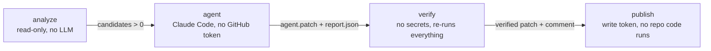

# Solution: unit test agent and PR workflow

A Claude Code agent that creates or updates unit tests for changed code in both stacks, runs them, and reports in the pull request. The same agent and skills run locally (`/unit-tests`) and in GitHub Actions.

## Main technical decisions

| Decision | Why |
|---|---|
| **Claude Code CLI called directly** (`claude -p "/unit-tests origin/main"`) instead of `claude-code-action` | The agent job has no GitHub token at all, and every flag is visible in the YAML: `--permission-mode dontAsk`, an explicit `--allowedTools`, `--strict-mcp-config`, `--max-turns`. The CI run is the same command as a local run. |
| **Four jobs with separate permissions** | The LLM never holds a write token, and the job with the write token holds no LLM secret and executes no repository code (only `git apply` and `gh`). A successful prompt injection can change files in a throwaway workspace and nothing else. |
| **Trusted agent config from the base branch** | `.claude/`, `.github/scripts/`, `.mcp.json` and every `CLAUDE.md` are replaced with the base-branch version before anything runs, including files the PR adds there. A PR cannot rewrite the rules the agent and the checks follow. |
| **Writer and read-only reviewer** | `unit-test-writer` writes tests; `unit-test-reviewer` (Read/Grep/Glob only) checks the plan against the source in both directions — `missing` cases and `padding` — and flags tests that would pass with the source line reverted. One fix round, no loop. |
| **Plan tied to source lines** | Before writing, the writer lists every case as `behaviour → file:line of the construct → test`. A case without a construct is not written; a construct without a case is a review note. Cases come from a shared checklist ([`edge-cases.md`](.claude/skills/analyze-changes/edge-cases.md)) of what each construct implies (branches, nullability, boundaries, error paths, abort, cache states). |
| **Every red test needs an outcome** | `fixed-test` (with the cause), `product-bug` (finding with expected vs actual), `pre-existing` (unrelated to the change), `blocked` or `unresolved`. "Gave up" is not an outcome; a buggy result is never asserted to make a test green. |
| **Deterministic controls over prompt rules** | Anything that can be checked by code is: path guard, Bash allowlist hook, report validator, independent re-run. The agent's claims are never trusted. |
| **Incremental analysis on follow-up pushes** | A `synchronize` push is compared with the previous head, intersected with the branch diff, so a style-only push does not start the agent and merges from `main` are never analysed. |
| **Sonnet, pinned versions** | Model is a workflow variable (`CLAUDE_MODEL`). Claude Code `2.1.300` and every action are pinned to releases at least two weeks old, actions by commit SHA. |

### Deterministic controls

| Control | Where | What it enforces |
|---|---|---|
| [`verify-patch.mjs`](.github/scripts/verify-patch.mjs) | agent run step 6, `verify` job | Only `backend/tests/**` and `*.test.ts(x)` change; no `.skip/.only/.todo/.fails/skipIf/runIf/xit/fit`; no deleted test files. Removed `expect(...)` lines in existing tests are listed for human review in the PR comment. |
| [`bash-allowlist.mjs`](.claude/hooks/bash-allowlist.mjs) | `PreToolUse` hook in the `unit-tests` skill (orchestrator) and in `settings.json` scoped to `agent_type == unit-test-writer` | Only the documented commands run; any `;`, `|`, `>`, `$(...)`, `cat`, `find`, `node -e`, `npx`, `curl`, `git push` is blocked. Files are written with Edit/Write only. |
| [`validate-report.mjs`](.claude/skills/unit-tests/validate-report.mjs) | agent run step 8, `verify` job | Plan sources are single existing `path:line`s in the file under test; every create/update has a plan entry or a `blocked` outcome; enums and causes are present. |
| `verify` job | CI | Applies the patch on a clean checkout and re-runs the guard, both type checks, both suites twice (flaky detection), coverage and coverage of changed lines. Tests are committed only if all pass, the agent job succeeded and a report exists. |
| [`render-comment.mjs`](.github/scripts/render-comment.mjs) | `verify` job | Agent text in the PR comment is escaped (no HTML, no `@mentions`, no table breaks). |

## Running the PR workflow

**Prerequisites**

- GitHub Actions enabled; workflow permissions may stay read-only — each job requests what it needs.
- Repository secret `CLAUDE_CODE_OAUTH_TOKEN` from `claude setup-token` (Claude subscription). An `ANTHROPIC_API_KEY` works with a one-line change in the agent step.
- The base branch contains `.claude/` — the agent always runs with the base branch's config.

**Triggers**

- Automatically on `pull_request` (`opened`, `synchronize`, `reopened`) from branches of this repository. Fork PRs are skipped: they receive no secrets.
- Manually: *Actions → Unit test agent → Run workflow* on a branch.
- Pushes by `github-actions[bot]` never start the agent.

**Results in the PR**: a commit `test: add unit tests from unit-test agent` on the PR branch, one sticky comment (checks, decisions, possible bugs, failing tests, removed assertions, open review notes, test plan), the job summary, and the `verified` artifact with the report, patch and session metadata.

**Locally**: open Claude Code in the repository (dependencies installed) and run `/unit-tests` (branch vs `origin/main`), `/unit-tests <base> --since <ref>`, or `/unit-tests --gaps` (files below 80 % line or branch coverage). [`ci.yml`](.github/workflows/ci.yml) runs type checks, tests with coverage thresholds and the script tests on every PR.

## Where the agent and skills are defined

| Path | Role |
|---|---|
| [`.claude/skills/unit-tests/`](.claude/skills/unit-tests/SKILL.md) | Entry point `/unit-tests`: analyze → writers (backend and frontend in parallel) → reviewer → one fix round → guard → report → validation. Registers the Bash hook. |
| [`.claude/agents/unit-test-writer.md`](.claude/agents/unit-test-writer.md) | Custom agent: baseline, plan, write, run, report outcomes. Preloads the three skills below. |
| [`.claude/agents/unit-test-reviewer.md`](.claude/agents/unit-test-reviewer.md) | Custom read-only agent: plan ↔ source ↔ test review with typed notes (`missing`, `padding`, `weak`, `unresolved-failure`, `convention`). |
| [`.claude/skills/analyze-changes/`](.claude/skills/analyze-changes/SKILL.md) | `classify.mjs` classifies changed files (skip rules are deterministic); the skill decides `create` / `update` / `skip` — type of change first, then a 4-metric score with a 50 % threshold. Holds `edge-cases.md`. |
| [`.claude/skills/backend-unit-tests/`](.claude/skills/backend-unit-tests/SKILL.md), [`frontend-unit-tests/`](.claude/skills/frontend-unit-tests/SKILL.md) | Repository conventions only, taken from the existing tests: Prisma spies without a database, Supertest, design-system mocks, React Query wrappers, jest-dom matchers. |
| [`.claude/skills/run-tests/`](.claude/skills/run-tests/SKILL.md) | `run.mjs` (Vitest JSON summary, `--repeat`, "no tests matched" is a failure), `diff-coverage.mjs`, baseline and failure-outcome rules. |
| [`.claude/hooks/`](.claude/hooks/bash-allowlist.mjs), [`.claude/settings.json`](.claude/settings.json) | Bash allowlist and its registration for writer subagents. |
| [`.github/workflows/unit-test-agent.yml`](.github/workflows/unit-test-agent.yml), [`.github/actions/prepare/`](.github/actions/prepare/action.yml), [`.github/scripts/`](.github/scripts) | The four jobs, the trusted-config step, the guard and the comment renderer. |

All helper scripts are dependency-free Node and covered by `node --test` (32 tests).

## Example runs

### Pull request [#1 — Clear completed tasks](https://github.com/dmtrmrz/taskly-app-node/pull/1)

The feature adds `DELETE /api/todos?completed=true` and a "Clear completed (n)" button. Existing tests were deliberately not updated by hand, so the feature commit broke 11 `TodosPage` tests and the type check of two test files.

| Push | Change | Agent | Verified results |
|---|---|---|---|
| [`1df76a0`](https://github.com/dmtrmrz/taskly-app-node/commit/1df76a0) feature | 10 files, both stacks | **1 create · 6 update · 3 skip** (`openapi.json`, `types.ts`, `queryKeys.ts`). Created the hook test, extended six existing test files and repaired the ten `TodosPage` tests the feature broke — outcome `fixed-test`: *"TodosPage now calls useClearCompletedMutation, which needs a QueryClient; the test did not mock the new hook"*. 20 plan entries. Commit [`aacdf1b`](https://github.com/dmtrmrz/taskly-app-node/commit/aacdf1b), 7 files. | Guard ✅ · type checks ✅ · backend 98/98, frontend 120/120 twice, 0 flaky · **changed-line coverage 100 % (24/24)** · [run](https://github.com/dmtrmrz/taskly-app-node/actions/runs/40947276682), $0.61 |
| [`d7359d5`](https://github.com/dmtrmrz/taskly-app-node/commit/d7359d5) behaviour change | notice shows the cleared count | **1 update · 9 skip** (unchanged behaviour). The test asserting the old message: outcome `fixed-test` — *"asserted the old message; source now notifies 'Cleared N completed task(s)'"* — replaced by `it.each` over 1, 3 and 0; the absence check was tightened to `not.toHaveBeenCalled()`. Commit [`b8049a5`](https://github.com/dmtrmrz/taskly-app-node/commit/b8049a5). | All ✅, frontend 122/122 · the three changed assertions appear under **Removed assertions — needs a human look** · [run](https://github.com/dmtrmrz/taskly-app-node/actions/runs/40948865901), $0.35 |
| [`48cee06`](https://github.com/dmtrmrz/taskly-app-node/commit/48cee06) style only | `styles.css` | Not started: 0 candidates since `b8049a5`. | [CI green](https://github.com/dmtrmrz/taskly-app-node/actions/runs/40957223209) on the whole PR |

Skills used in each run: `analyze-changes` (orchestrator), `backend-unit-tests` / `frontend-unit-tests` and `run-tests` (preloaded into the writers), `unit-tests` (entry point).

### Coverage gaps in the existing code (`/unit-tests --gaps`, local)

| | Before | After ([`c88293a`](https://github.com/dmtrmrz/taskly-app-node/commit/c88293a)) |
|---|---|---|
| Backend lines / branches | 33 % / 33 % · 48 tests | 92 % / 100 % · 87 tests |
| Frontend lines / branches | 48 % / 44 % · 18 tests | 91 % / 93 % · 106 tests |

24 files analysed, 16 tested, 8 skipped with a score (`health.ts` 35 %, `AppProviders.tsx` 25 %, …). The reviewer raised 14 notes on the first version, mostly `missing` cases (id above `MAX_SAFE_INTEGER`, timer cleanup on unmount, sort tie-break, `headersSent` in the error handler), all fixed.

This result is the third run. Each earlier run exposed a gap, fixed in the agent rather than in the tests: a writer editing files through `python3` heredocs (→ Bash allowlist hook), the hook not reaching subagents (→ `settings.json` registration scoped by `agent_type`), logic inside `expect`, absence assertions that could never fail, plan entries as line ranges (→ report validator). The CI demo then exposed four workflow issues, also fixed: hidden-directory artifact upload, the agent being re-queued on its own commit, baseline failures caused by the PR treated as pre-existing, and full re-analysis on every push.

## Assumptions

- Same-repository PRs from collaborators; fork PRs are out of scope because they get no secrets.
- Unit tests only: no PostgreSQL, no network, no browser. Repository layout and conventions are those of this project (`backend/tests/*.test.ts`, colocated frontend tests).
- The base branch is reviewed; its `.claude/` is the trusted configuration.
- Committing verified tests directly to the PR branch is acceptable; the author reviews them like any other commit.

## Limitations

- **Workflow definition comes from the PR.** For `pull_request` events GitHub runs the workflow file from the PR branch, so a collaborator could still change the workflow itself; the base-branch overlay protects the agent config and scripts, not the YAML.
- **Bot commits.** GitHub queues runs triggered by the bot's push as `action_required`, so CI does not run on the agent's commit until the next human push or a manual approval (approving is safe: the agent job skips itself).
- **One review round.** `fixed` on a review note is the writer's claim; there is no second review.
- **Incremental analysis** trusts the previous push's run: if it failed, files from that push are not re-analysed on the next push (a manual run analyses the whole branch).
- **"Possible bug" detection** depends on the model reading intent from the diff; a wrong intent can still be encoded as expected behaviour, which is why changed assertions are always surfaced for human review.
- Reviewer and writer use the same model family, so they share blind spots.

## For a production version

- A GitHub App token for the publish job, so CI runs on the agent's commit without approval, and branch protection that requires it.
- The secret in a protected environment with required reviewers, or `pull_request_target` with an explicit label gate, so workflow changes in a PR cannot reach it.
- Mutation testing (e.g. Stryker) on changed files as an objective check for `weak` and `missing`, replacing part of the LLM review.
- Package the agents, skills and hooks as a Claude Code plugin with a versioned config, reused across repositories.
- Persist per-run metrics (cost, turns, decisions, blocked commands, review notes) to watch agent quality over time.
- Suggestions as a review (`suggestion` blocks) instead of a commit, as an option for teams that do not want bot commits.
